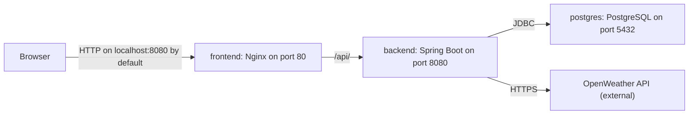

# Weather Dashboard

## Project Overview

Weather Dashboard is a full-stack web application built for a university
Distributed Systems course. The first milestone uses Docker Compose to run
three containerized services: `frontend`, `backend`, and `postgres`.
The historical submission is recorded in the
[course-compose-v1.0.0 release notes](docs/releases/course-compose-v1.0.0.md).

## Features

- Search by city name or use browser location detection.
- View current conditions, hourly and daily forecasts, and details such as
  humidity, wind, pressure, visibility, UV index, sunrise, and sunset.
- Register and sign in to save, reopen, and remove favorite locations.
  City search and weather are available to guests.

## Technology Stack

| Area | Technologies |
| --- | --- |
| Frontend | Vite 8, vanilla JavaScript, HTML/CSS, Nginx |
| Backend | Java 17, Spring Boot 4, Spring Security with JWT, Maven, OpenWeather |
| Database | PostgreSQL 16, Flyway |
| Infrastructure | Docker Compose, multi-stage builds, health checks, named volume |
| Testing | Vitest, JUnit, Maven Failsafe for PostgreSQL integration tests |

## System Architecture



- **`frontend`** is the browser's entry point. Nginx serves the static Vite
  build and proxies same-origin requests under `/api/` to Spring Boot,
  preserving paths and query strings. The frontend JavaScript runs in the browser.
- **`backend`** serves the REST API, validates requests, handles authentication
  and JWTs, retrieves geocoding and forecast data from the external OpenWeather
  API, and reads and writes application data and the weather cache in PostgreSQL.
- **`postgres`** stores user accounts, favorite locations, the JSONB weather
  cache, and Flyway migration history. The backend applies migrations on startup.

Compose puts the services on a shared project network. Docker's internal DNS
resolves the service names `backend` and `postgres`, so Nginx can reach
`backend:8080` and Spring Boot can reach `postgres:5432`. Nginx is the only
service with a published host port. By default, `127.0.0.1:8080` maps to
Nginx's internal port `80`.

## Prerequisites

- Git to clone the repository.
- Docker Desktop or Docker Engine with the Docker Compose plugin and support
  for Linux containers.
- Internet access to pull images, download dependencies, and call OpenWeather.
  Live forecasts require an OpenWeather key with One Call 3.0 access.

The Docker-only workflow needs no local Java, Maven, or Node.js installation.
The multi-stage images build the backend JAR with Maven and the Vite assets
with Node.js, then package those outputs in the runtime images.

## Configuration

From the repository root, create `.env` if you do not already have one.

Linux or macOS:

```sh
cp .env.example .env
```

Windows PowerShell:

```powershell
Copy-Item .env.example .env
```

Edit `.env` locally. The `weather` database name and user from the template
are suitable for a fresh setup. Choose a database password, generate a signing
secret, and supply your own OpenWeather key.

| Variable | Role and value |
| --- | --- |
| `DB_NAME` | Required PostgreSQL database name. The template uses `weather`. |
| `DB_USER` | Required PostgreSQL user. The template uses `weather`. PostgreSQL initializes this account and Spring Boot uses it to connect. |
| `DB_PASS` | Required PostgreSQL password. Choose a private value for a new database and keep it consistent with any existing volume. |
| `JWT_SECRET` | Required signing key for issuing and validating HS256 session tokens. Use standard Base64 encoding of at least 32 random bytes. |
| `OPENWEATHER_API_KEY` | Required provider key with access to Direct Geocoding (`/geo/1.0/direct`) and One Call 3.0 (`/data/3.0/onecall`). The forecast endpoint requires the [OpenWeather One Call API subscription](https://openweathermap.org/api/one-call-3). |
| `FRONTEND_PORT` | Optional host port for Nginx, default `8080`. |
| `OPENWEATHER_BASE_URL` | Optional provider base URL, default `https://api.openweathermap.org`. |
| `OPENWEATHER_CONNECT_TIMEOUT`, `OPENWEATHER_READ_TIMEOUT` | Optional positive durations, default `3s` and `10s`. |
| `WEATHER_CACHE_TTL` | Optional positive duration controlling cache freshness, default `10m`. |
| `DB_URL` | For a backend run directly on the host. Compose sets the backend URL to `jdbc:postgresql://postgres:5432/${DB_NAME}`. |

Generate 32 random bytes and encode them as Base64. On Linux or macOS with
OpenSSL available:

```sh
openssl rand -base64 32
```

In PowerShell:

```powershell
$bytes = New-Object byte[] 32
$rng = [System.Security.Cryptography.RandomNumberGenerator]::Create()
$rng.GetBytes($bytes)
[Convert]::ToBase64String($bytes)
$rng.Dispose()
```

Copy the single output line into `JWT_SECRET`. Keep the secret stable across
restarts because replacing it invalidates existing tokens. Compose reads
`.env` for variable substitution, and variables exported in your shell can
override those values. Git ignores `.env`. Keep it private and never commit it.

## Run with Docker Compose

1. Clone the repository and enter its root directory.

   ```sh
   git clone https://github.com/cashtad/weather.git
   cd weather
   ```

2. Create and populate `.env` as described in [Configuration](#configuration).
3. Start Docker Desktop or Docker Engine and wait for it to be ready.
4. Validate the Compose configuration without printing resolved values, then
   build and launch the services in the background.

   ```sh
   docker compose config --quiet
   docker compose up --build -d
   ```

   Continue to the build when validation succeeds. The first build can take
   several minutes while Docker pulls base images and downloads dependencies.
5. Run `docker compose ps` and wait until `postgres`, `backend`, and
   `frontend` all report `(healthy)`. Recheck if a service is still starting.
6. Open [http://localhost:8080](http://localhost:8080) in a browser. If you
   changed `FRONTEND_PORT`, use that port throughout the walkthrough.

Compose starts the backend after PostgreSQL passes `pg_isready`, then starts
Nginx after the backend's `/actuator/health/readiness` passes. Backend
readiness includes a database check. Nginx's `/healthz` returns HTTP 204
and checks that Nginx responds. The probes cover local service health.
Use the weather search below to verify OpenWeather access.

## Verifying Functionality

1. **Container health.** Run the command below. Expect three running services,
   `frontend`, `backend`, and `postgres`, each marked `(healthy)`.

   ```sh
   docker compose ps
   ```

2. **Frontend access.** Open [http://localhost:8080](http://localhost:8080).
   Expect the **Weather** header and usable search and account controls served
   by Nginx. Narrow the browser window and confirm the controls remain usable.
   Confirm the dashboard loads without a blocking API error.
3. **Weather search.** Type `Prague` into the city search and select the
   result for Prague, Czechia. Expect the current temperature and a weather icon,
   **Hourly forecast** cards, daily rows under **Weekly forecast**, and
   **Weather details** such as humidity and wind. To check location detection,
   click **Use my location** beside the search and allow the browser prompt if
   shown. A fresh forecast and live city search require network access and a
   working OpenWeather key.
4. **Registration and login.** Select **Sign in**, then **Create an account**.
   Register with a new test email and a password you choose. Registration
   signs you in. Expect your email and **Sign out** in the header. Sign out
   and sign in again with the same credentials to verify login separately.
5. **Favorites.** While signed in, select a named city and click the
   **Save city** heart on its current-weather card. Clear the search field if
   it contains text, then focus it to open **Saved places**. Expect the saved
   city to appear. Select it and confirm that its weather loads. Keep it
   saved for the next step. Afterwards, you can optionally click **Remove**
   and confirm the entry disappears.
6. **Data persistence.** Sign out and run the following from the same
   Compose project, keeping its name and database settings.

   ```sh
   docker compose down
   docker compose up -d
   docker compose ps
   ```

   Wait for all three services to be healthy, then sign back in with the same
   test account. Expect the city to still be listed under **Saved places**.
   The recreated database container mounts the same named `pgdata` volume.
   **Never use `docker compose down -v` for this check.** It removes the
   named database volume and can destroy the stored data.
7. **API and reverse proxy.** Open
   [the Prague search API](http://localhost:8080/api/v1/geo/search?name=Prague)
   in a browser, or run the command below. Use `curl.exe` in PowerShell if
   `curl` is an alias.

   ```sh
   curl -i "http://localhost:8080/api/v1/geo/search?name=Prague"
   ```

   Expect HTTP 200 and a JSON array of matches containing fields such as
   `name`, `country`, `lat`, and `lon`. This public endpoint takes the
   `name` query parameter and needs no JWT. Nginx forwards it to Spring Boot,
   which calls OpenWeather Direct Geocoding using the configured provider key.
8. **Logs.** Inspect the recent logs and watch the backend while you repeat a
   request. Expect startup messages from Nginx, Spring Boot, and PostgreSQL.
   In the backend logs, look for Flyway migration or schema validation messages
   and successful application startup. If a check fails, review the logs for
   errors at the time of the failure. Press Ctrl+C to stop following the logs.

   ```sh
   docker compose logs --tail 50
   docker compose logs -f backend
   ```

### REST API Reference

All paths below are available through the Nginx host port.

| Method and path | Inputs and access |
| --- | --- |
| `GET /api/v1/geo/search` | Public. Query parameter `name`. |
| `GET /api/v1/weather/all` | Public. Query parameters `lat` and `lon`. Returns current, hourly, and daily weather for the dashboard. |
| `GET /api/v1/weather/current`, `/api/v1/weather/hourly`, `/api/v1/weather/daily` | Public. Each takes `lat` and `lon`. |
| `POST /api/v1/auth/register`, `POST /api/v1/auth/login` | Public. Accept JSON with `email` and `password` and return a JWT. |
| `GET /api/v1/user/me` | Bearer JWT. Returns the signed-in user's profile. |
| `GET /api/v1/favorites`, `POST /api/v1/favorites` | Bearer JWT. List or save locations for the signed-in user. |
| `DELETE /api/v1/favorites/{id}` | Bearer JWT. Remove a saved location by UUID. |

## Docker Operations

Run these commands from the repository root.

| Task | Command |
| --- | --- |
| Start or recreate the stack with existing images | `docker compose up -d` |
| Stop containers and keep them for later | `docker compose stop` |
| Start existing stopped containers | `docker compose start` |
| View service status and health | `docker compose ps` |
| Read or follow logs | `docker compose logs --tail 50` or `docker compose logs -f backend` |
| Rebuild and start after source changes | `docker compose up --build -d` |
| Remove containers and the project network while keeping data | `docker compose down` |

## Data Persistence

The named `pgdata` volume is mounted at `/var/lib/postgresql/data` in
`postgres`. It holds accounts, favorites, cached forecasts, and migration
history across stops and normal container recreation. Reuse the same
Compose project name and database credentials to keep using the existing
database. PostgreSQL's initialization settings apply when the data directory
is first created. Editing `.env` alone cannot change credentials inside an
initialized volume.

**`docker compose down -v` removes the named volume and deletes its database
contents.** Use plain `docker compose down` for normal shutdown.

## Automated Tests

### Frontend

Use Node.js 24 and npm 10 or later. The supported Node.js versions are listed
in [frontend/package.json](frontend/package.json). Run from the repository root.
On PowerShell, use `npm.cmd` if the `npm.ps1` shim is blocked.

```sh
cd frontend
npm ci
npm test
npm run build
```

`npm test` runs Vitest once using mocked browser and API dependencies.
`npm run build` writes the production assets to `frontend/dist/`.

### Backend

Use JDK 17 and the Maven Wrapper from the repository root. The ordinary suite
needs no running PostgreSQL or live OpenWeather credentials. The `test` phase
runs the ordinary tests. The `verify` phase runs them, builds the JAR, and
completes the default verification lifecycle.

Linux or macOS:

```sh
./mvnw test
./mvnw verify
```

Windows PowerShell:

```powershell
.\mvnw.cmd test
.\mvnw.cmd verify
```

### PostgreSQL integration tests

Provision a separate, disposable PostgreSQL 16 instance before enabling the
`postgres-it` profile. Maven and `PostgresCacheIT` expect an already running
database. The test user needs permission to create schemas and to install
`uuid-ossp` in `public` if the extension is absent. Use a test instance
separate from the application database.

For example, set `POSTGRES_PASSWORD` in your shell to a new temporary test
password, then run this container in a separate terminal session from Maven.
Use an unused host port if `55432` is occupied. The example stores the test
database on a temporary filesystem for the duration of the container run.

```sh
docker run --rm --name weather-postgres-it -p 127.0.0.1:55432:5432 --tmpfs /var/lib/postgresql/data -e POSTGRES_DB=weather_it -e POSTGRES_USER=weather_it -e POSTGRES_PASSWORD postgres:16
```

Wait for PostgreSQL to accept connections. Set these variables in the shell
where you will run Maven. If you provisioned your own test instance, use its
connection details instead.

| Variable | Value for the example instance |
| --- | --- |
| `TEST_DB_URL` | `jdbc:postgresql://127.0.0.1:55432/weather_it` |
| `TEST_DB_USER` | `weather_it` |
| `TEST_DB_PASS` | The same temporary password supplied to that container. |

Run from the repository root on Linux or macOS:

```sh
./mvnw -Ppostgres-it verify
```

On Windows PowerShell:

```powershell
.\mvnw.cmd -Ppostgres-it verify
```

Failsafe runs `PostgresCacheIT` after the ordinary tests. The integration
suite creates a unique schema and tests Flyway migrations and PostgreSQL
cache behavior. Missing database settings fail the integration test. Schema
data remains in the test instance until it is removed. If you used the example
container, press Ctrl+C in its terminal after the run to stop and remove it.

## Troubleshooting

| Symptom | What to check |
| --- | --- |
| Docker cannot connect to its daemon | Start Docker Desktop or Docker Engine, then retry `docker compose ps`. On Docker Desktop, check that the Linux engine is running. |
| Host port 8080 is busy | Inspect the startup error and `docker compose ps`. Set `FRONTEND_PORT` to a free port, rerun `docker compose up -d`, and open the new port. |
| Compose reports a missing setting | Check the named variable in `.env` and any shell override. Rerun `docker compose config --quiet`. |
| Backend reports a JWT configuration error | Check `docker compose logs backend`. Ensure the signing secret is standard Base64 with at least 32 decoded bytes. Apply the corrected environment with `docker compose up -d`. |
| A service is unhealthy or the backend cannot connect to PostgreSQL | Run `docker compose ps`, `docker compose logs backend`, and `docker compose logs postgres`. Check for database startup, credential, or migration errors. If reusing a volume, verify that the credentials match the initialized database. |
| The frontend shows an API error | Repeat the failed request and check its status in the browser's Network tab. Compare with `docker compose logs frontend` and `docker compose logs backend` for proxy or application errors. |
| Search or forecasts fail while services are healthy | Check `docker compose logs backend` for OpenWeather connection, authentication, or rate-limit errors. Verify the key, its One Call 3.0 subscription, available quota, and network access. |
| The first image build takes longer than expected | Check the build output for image pulls and Maven or npm downloads. If a download fails, check network or registry access and retry `docker compose up --build -d`. |

## Project Structure

```text
README.md
docker-compose.yml                  # Three services, startup checks, and volume
Dockerfile                          # Maven build and Java 17 runtime
.env.example                        # Compose configuration template
pom.xml                             # Backend dependencies and test profile
mvnw / mvnw.cmd                      # Maven Wrapper launchers
src/
  main/java/com/example/weather/     # Spring Boot API and application logic
  main/resources/application.yaml   # Backend runtime settings
  main/resources/db/migration/      # Flyway SQL migrations
  test/java/com/example/weather/    # Backend tests
frontend/
  Dockerfile                        # Vite build and Nginx runtime
  nginx.conf                        # Static hosting and API reverse proxy
  package.json                      # Frontend dependencies and scripts
  src/                              # Frontend JavaScript, CSS, and Vitest tests
docs/                               # Course demonstration and release material
```

See the [course demonstration guide](docs/course-demo.md),
[Stage 4 handoff](docs/stage-4-handoff.md), and
[frontend development guide](frontend/README.md) for further details.

## Known Limitations

- The Compose milestone runs one local instance over plain HTTP on loopback.
- Live geocoding and forecasts depend on OpenWeather availability and quota.
- Browser geolocation requires permission and a secure context such as
  localhost or HTTPS. Manual city search works without location permission.
- The session token is kept in browser tab storage. Signing out clears the
  local session. Issued JWTs remain valid until they expire.
